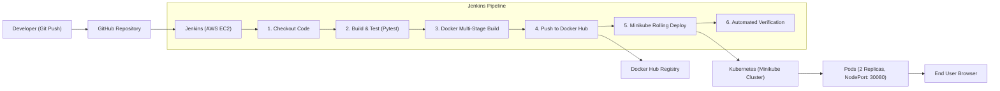

# SpecGen AI — CI/CD Pipeline & Automated Kubernetes Deployment

> **Course:** TYCSE · Cloud Computing and DevOps (CCD) — Continuous Assessment 2 (CCA 2)  
> **Evaluation Marks:** 10 Marks  
> **Application:** SpecGen AI (Fullstack AI-Powered Software Requirement Specification Generator)  
> **Tech Stack:** Python 3.11, FastAPI, React + Vite, Docker, Jenkins, Kubernetes (Minikube), AWS EC2

---

## 1. Project Overview

**SpecGen AI** is an intelligent web application designed to accelerate the software engineering requirements phase. It accepts natural-language software project concepts and generates comprehensive Software Requirement Specifications (SRS), including:
- Project Classification & Domain Detection
- Numbered Functional Requirements (with MoSCoW prioritization)
- Agile User Stories with acceptance criteria
- Structured Use Cases (preconditions, main flow, postconditions)
- Risk Matrix & Cost Estimation breakdown
- Deterministic Sprint Allocation Plan
- Document Exports in PDF and Word (`.docx`) formats

### Application Architecture
- **Backend:** FastAPI (Python), SQLAlchemy, SQLite/PostgreSQL, ReportLab & python-docx for document generation.
- **Frontend:** React 18, Vite, React Router 6, responsive modern dark UI.
- **Testing:** Comprehensive test suite of **61 automated unit/integration tests** using `pytest` and FastAPI's `TestClient` (no external API keys required during CI).



---

## 2. Repository Structure

```text
ccd/
├── .gitignore                    # Production gitignore (Python, Node, DB, secrets)
├── Dockerfile                    # Multi-stage production container build
├── Jenkinsfile                   # Declarative Jenkins CI/CD pipeline
├── README.md                     # Comprehensive documentation & evaluation report
├── backend/                      # FastAPI backend application
│   ├── app/
│   │   ├── routers/              # Auth, Projects, Admin routes
│   │   ├── ai_engine.py          # AI prompt orchestration & model logic
│   │   ├── auth.py               # JWT authentication & bcrypt password hashing
│   │   ├── database.py           # SQLAlchemy database session & engine
│   │   ├── export.py             # PDF & DOCX export builders
│   │   ├── main.py               # FastAPI entrypoint, healthcheck, SPA static serving
│   │   ├── models.py             # ORM database models
│   │   ├── planning.py           # Deterministic sprint planning algorithm
│   │   ├── review.py             # Rule-based ambiguity & duplicate detector
│   │   └── schemas.py            # Pydantic validation schemas
│   ├── tests/                    # 61 automated pytest test cases
│   ├── requirements.txt          # Production backend dependencies
│   ├── requirements-dev.txt      # Testing & development dependencies
│   └── pytest.ini                # Pytest configuration
├── frontend/                     # React + Vite frontend application
│   ├── src/
│   │   ├── pages/                # Login, Register, Dashboard, ProjectView, Admin
│   │   ├── api.js                # Dynamic API client supporting Docker & K8s
│   │   ├── App.jsx               # Navigation router & layout
│   │   └── styles.css            # Custom UI styling
│   ├── package.json              # Frontend npm dependencies
│   └── vite.config.js            # Vite bundler config with local reverse proxy
├── k8s/                          # Kubernetes Manifests
│   ├── configmap.yaml            # Environment configuration
│   ├── deployment.yaml           # Deployment (2 replicas, rolling updates, health probes)
│   └── service.yaml              # NodePort Service (Port 30080 -> 8000)
└── scripts/
    └── aws-setup.sh              # 1-click EC2 provisioning script for AWS
```

---

## 3. Automated CI/CD Pipeline Stages

The Jenkins declarative pipeline defined in [`Jenkinsfile`](file:///c:/Users/zainu/Downloads/ccd/Jenkinsfile) executes 6 automated stages:

| Stage # | Stage Name | Description & Actions Performed |
|:---:|:---|:---|
| **1** | **Checkout** | Clones latest source code branch from GitHub using SCM credentials and prints commit metadata. |
| **2** | **Build & Test** | Initializes a Python virtual environment, installs development dependencies, and executes 61 automated pytest tests (`pytest tests/ -v`). Fails pipeline if any test breaks. |
| **3** | **Docker Build** | Runs a multi-stage Docker build packaging the compiled React frontend and the FastAPI backend into an optimized runtime image, tagged with `${BUILD_NUMBER}` and `latest`. |
| **4** | **Push Image** | Uses Jenkins encrypted credentials (`dockerhub-credentials`) to authenticate with Docker Hub and securely push image tags `${IMAGE_NAME}:${BUILD_NUMBER}` and `${IMAGE_NAME}:latest`. |
| **5** | **Minikube Deployment** | Applies Kubernetes manifests (`kubectl apply -f k8s/`), updates container image to the new build tag (`kubectl set image`), and verifies rolling deployment status (`kubectl rollout status`). |
| **6** | **Verification** | Inspects running pods, deployments, and services (`kubectl get pods,svc,deploy -l app=specgen-ai`), queries application healthcheck endpoint (`/health`), and ensures zero-downtime availability. |

---

## 4. Multi-Stage Dockerfile Design

The containerization uses a clean **multi-stage build** in [`Dockerfile`](file:///c:/Users/zainu/Downloads/ccd/Dockerfile):
1. **Frontend Builder (`node:20-alpine`):** Installs npm dependencies, bundles Vite React frontend into production-ready static assets in `dist/`.
2. **Backend Runtime (`python:3.11-slim`):**
   - Installs minimal system libraries and Python packages.
   - Copies backend code.
   - Copies frontend static assets into `/app/static`.
   - FastAPI serves both the REST API and the React SPA under a single unified port `8000`.
   - Configures an internal `HEALTHCHECK` probing `http://localhost:8000/health`.

---

## 5. Kubernetes Architecture & Manifests

All Kubernetes definitions reside in the [`k8s/`](file:///c:/Users/zainu/Downloads/ccd/k8s) folder:

### 1. Deployment (`k8s/deployment.yaml`)
- **Replicas:** 2 pods for high availability and redundancy.
- **Update Strategy:** `RollingUpdate` with `maxSurge: 1` and `maxUnavailable: 0` ensuring zero downtime during pipeline redeployments.
- **Resource Limits:** Requests (100m CPU / 128Mi RAM), Limits (500m CPU / 512Mi RAM).
- **Probes:**
  - `livenessProbe`: Verifies container health every 10s via `GET /health`.
  - `readinessProbe`: Ensures pod traffic routing only occurs once the application is ready.

### 2. Service (`k8s/service.yaml`)
- **Type:** `NodePort`
- **Port:** `8000` (target container port `8000`)
- **NodePort:** `30080` (allows direct public access on `http://<EC2-IP>:30080` or `http://<Minikube-IP>:30080`).

---

## 6. AWS EC2 & Jenkins Setup Guide (Step-by-Step)

### Step 1: Launch an AWS EC2 Instance
- **AMI:** Ubuntu Server 22.04 LTS or 24.04 LTS (64-bit x86)
- **Instance Type:** `t3.medium` or `t2.medium` (Minimum 2 vCPUs, 4 GB RAM recommended for running Jenkins + Minikube)
- **Storage:** 25 GB - 30 GB gp3
- **Security Group Inbound Rules:**
  - `SSH` (Port `22`) — Source: `My IP`
  - `Custom TCP` (Port `8080`) — Source: `Anywhere (0.0.0.0/0)` (Jenkins Web Dashboard)
  - `Custom TCP` (Port `30080`) — Source: `Anywhere (0.0.0.0/0)` (SpecGen AI Web App NodePort)

### Step 2: Install Prerequisites using the Provisioning Script
SSH into your EC2 instance:
```bash
ssh -i "your-key.pem" ubuntu@<EC2-PUBLIC-IP>
```

Clone your repository and run the setup script:
```bash
git clone https://github.com/<YOUR_GITHUB_USERNAME>/<YOUR_REPO_NAME>.git
cd <YOUR_REPO_NAME>
chmod +x scripts/aws-setup.sh
./scripts/aws-setup.sh
```
*(Or execute commands individually as documented inside [`scripts/aws-setup.sh`](file:///c:/Users/zainu/Downloads/ccd/scripts/aws-setup.sh).)*

### Step 3: Start Minikube
Run as standard user `ubuntu`:
```bash
minikube start --driver=docker
```

Configure Jenkins to access Minikube and `kubectl`:
```bash
sudo mkdir -p /var/lib/jenkins/.kube /var/lib/jenkins/.minikube
sudo cp -r ~/.kube/config /var/lib/jenkins/.kube/
sudo cp -r ~/.minikube/* /var/lib/jenkins/.minikube/ 2>/dev/null || true
sudo chown -R jenkins:jenkins /var/lib/jenkins/.kube /var/lib/jenkins/.minikube
```

Verify `jenkins` user can access Minikube:
```bash
sudo -u jenkins kubectl get nodes
```

### Step 4: Configure Jenkins
1. Open `http://<EC2-PUBLIC-IP>:8080` in your browser.
2. Get the initial unlock password:
   ```bash
   sudo cat /var/lib/jenkins/secrets/initialAdminPassword
   ```
3. Install Suggested Plugins and create your Admin user.
4. Go to **Manage Jenkins** -> **Plugins** -> **Available Plugins**, install:
   - **Docker Pipeline**
   - **Pipeline: Stage View**
5. Go to **Manage Jenkins** -> **Credentials** -> **System** -> **Global credentials (unrestricted)**:
   - Click **Add Credentials**
   - **Kind:** Username with password
   - **Username:** Your Docker Hub username (e.g. `zainu`)
   - **Password:** Your Docker Hub Personal Access Token (or password)
   - **ID:** `dockerhub-credentials` (Must match the `DOCKER_CREDENTIALS_ID` in `Jenkinsfile`)
   - Click **Create**.

### Step 5: Create the Jenkins Pipeline Job
1. Click **New Item** on Jenkins dashboard.
2. Enter name: `specgen-ai-pipeline`, select **Pipeline**, click **OK**.
3. Under **Pipeline** configuration:
   - **Definition:** `Pipeline script from SCM`
   - **SCM:** `Git`
   - **Repository URL:** `https://github.com/<YOUR_GITHUB_USERNAME>/<YOUR_REPO_NAME>.git`
   - **Branch Specifier:** `*/main`
   - **Script Path:** `Jenkinsfile`
4. Click **Save**.
5. Click **Build Now** to trigger the first automated build!

---

## 7. Demonstrating Code-Change & Automated Redeployment (Second Run)

The rubric mandates demonstrating an automated redeployment upon code change:

### Step 1: Verify Build #1
1. Build #1 succeeds in Jenkins with all stages green.
2. Check the app in browser at `http://<EC2-PUBLIC-IP>:30080` (or `http://localhost:30080`).
3. Check the health endpoint:
   ```bash
   curl http://<EC2-PUBLIC-IP>:30080/health
   # Returns: {"status":"ok","app":"SpecGen AI","version":"1.0.0","environment":"production"}
   ```

### Step 2: Make a Code Change
Open `backend/app/main.py` and update the version string:
```python
# Change version from "1.0.0" to "2.0.0"
app = FastAPI(
    title="SpecGen AI",
    description="AI-assisted platform for generating software requirement specifications.",
    version="2.0.0",
)
```
And in `health()` endpoint:
```python
@app.get("/health")
def health():
    return {
        "status": "ok",
        "app": "SpecGen AI",
        "version": "2.0.0",
        "environment": os.environ.get("ENVIRONMENT", "production"),
    }
```
*(Optionally also add a visual badge in `frontend/src/App.jsx` such as `v2.0` in the header).*

### Step 3: Commit and Push
```bash
git add backend/app/main.py
git commit -m "feat: release version 2.0.0 update for automated CI/CD demo"
git push origin main
```

### Step 4: Run Build #2 in Jenkins
1. Trigger **Build Now** in Jenkins (or let GitHub Webhook trigger it automatically).
2. Jenkins pulls new commit, runs test suite, builds `specgen-ai:2`, pushes to Docker Hub, and applies rolling update to Minikube.
3. Observe pods during deployment:
   ```bash
   kubectl rollout status deployment/specgen-ai
   ```
4. Query healthcheck endpoint again:
   ```bash
   curl http://<EC2-PUBLIC-IP>:30080/health
   # Returns: {"status":"ok","app":"SpecGen AI","version":"2.0.0","environment":"production"}
   ```
This demonstrates complete zero-downtime automated deployment of the new application version!

---

## 8. Verification & Screenshots Submission Checklist

For full marks (10/10), capture and attach the following screenshots to your report:

- [ ] **Screenshot 1:** GitHub repository page showing project structure (`backend/`, `frontend/`, `k8s/`, `Dockerfile`, `Jenkinsfile`).
- [ ] **Screenshot 2:** AWS EC2 Management Console showing the running EC2 instance and Security Group rules (ports 22, 8080, 30080 open).
- [ ] **Screenshot 3:** Jenkins credentials manager showing `dockerhub-credentials` securely configured.
- [ ] **Screenshot 4:** Successful **Build #1** in Jenkins Pipeline Stage View (all 6 stages green: Checkout, Build & Test, Docker Build, Push Image, Minikube Deployment, Verification).
- [ ] **Screenshot 5:** Docker Hub repository showing the pushed image tags (`latest`, `1`, `2`).
- [ ] **Screenshot 6:** Terminal output of `kubectl get pods,deployment,svc -o wide` showing running pods and NodePort service.
- [ ] **Screenshot 7:** Browser / Terminal showing application response for Version 1.0.0 vs Version 2.0.0 (`http://<EC2-IP>:30080` and `curl /health`).

---

## 9. Viva Voce Q&A Cheat Sheet

| Question | Answer Summary |
|---|---|
| **What is the difference between CI and CD?** | **CI (Continuous Integration)** automates the merging, building, and testing of code changes to catch defects early. **CD (Continuous Delivery/Deployment)** automatically packages and releases verified changes to staging/production clusters without manual intervention. |
| **Why use a multi-stage Docker build?** | It separates the build environment (Node.js SDK, npm packages, build tools) from the lightweight runtime image (Python slim). This drastically reduces image size, speeds up download times, and eliminates unnecessary tools to reduce security vulnerabilities. |
| **Why use NodePort in Minikube rather than ClusterIP or LoadBalancer?** | `ClusterIP` is only accessible inside the Kubernetes internal cluster network. `LoadBalancer` requires cloud provider APIs (e.g. AWS ELB). `NodePort` exposes a static port (30080) on the node/EC2 host IP, allowing easy external browser access in local/testing setups. |
| **How does RollingUpdate achieve zero downtime?** | Kubernetes spins up a new pod with the new version first. Once the readiness probe passes, it directs traffic to the new pod and only then terminates the old replica (`maxUnavailable: 0`, `maxSurge: 1`). |
| **Why are liveness and readiness probes required?** | `livenessProbe` checks if the container is running and restarts it if deadlocked. `readinessProbe` checks if the application is fully initialized to receive incoming user traffic. |
